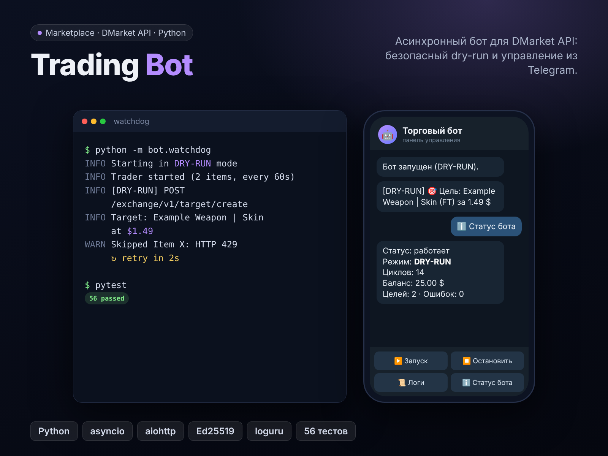

# Marketplace Trading Bot

Асинхронный торговый бот на Python для маркетплейса DMarket (API v2): следит за ценами из списка, ставит заявки на покупку, выставляет купленное на продажу, присылает уведомления в Telegram и управляется кнопками прямо из чата. Рядом работает watchdog, который перезапускает бота, если он упал или завис.

Это витринная версия моего торгового бота: архитектура, подпись запросов, безопасность и тесты настоящие, а торговая стратегия намеренно упрощена до заглушки. Боевая логика в репозиторий не входит. Проект не связан с DMarket.



*Установка зависимостей и 56 пройденных тестов.*

## Возможности

- **Режим DRY-RUN по умолчанию**: бот ходит в API, читает цены и баланс, но любые операции записи (заявки, продажи) только пишет в лог. Реальные сделки включаются отдельно: `DRY_RUN=0`
- **Подпись запросов DMarket API v2** (Ed25519): строка подписи собирается в одном месте и совпадает с тем, что уходит по сети
- **Устойчивый клиент**: пауза между запросами, повторы при 429/5xx и обрывах связи, экспоненциальная пауза с jitter, поддержка `Retry-After`
- **Деньги в центах** (целые числа), никаких ошибок округления float
- **Telegram-панель из 4 кнопок**: Запуск, Остановить, Логи, Статус бота. Бот слушает только ваш chat id, чужие сообщения игнорируются
- **Уведомления** о новых заявках и выставленных предметах
- **Watchdog**: перезапускает бота при падении или когда файл-heartbeat давно не обновлялся; паузы между перезапусками растут, чтобы не крутить процессор в цикле сбоев
- Один сбойный предмет или упавший цикл не останавливают бота
- Секреты не попадают в логи и `repr` настроек, токен Telegram не попадает в тексты ошибок

## Стек

Python 3.10+, asyncio, aiohttp, PyNaCl (Ed25519), loguru, python-dotenv, pytest

## Быстрый старт

Windows:

```bash
py -3.12 -m venv .venv
.venv\Scripts\activate
pip install -r requirements.txt
copy .env.example .env
copy watchlist.example.json watchlist.json
notepad .env
python -m bot.main
```

Linux / macOS:

```bash
python3 -m venv .venv
source .venv/bin/activate
pip install -r requirements.txt
cp .env.example .env
cp watchlist.example.json watchlist.json
nano .env
python -m bot.main
```

В `.env` впишите свои ключи DMarket. Пока `DRY_RUN=1`, бот ничего не покупает и не продаёт, а в логе появятся строки вида `[DRY-RUN] POST /exchange/v1/target/create ...`.

Чтобы бота перезапускал watchdog, запускайте `python -m bot.watchdog` вместо `python -m bot.main`.

## Настройка

Переменные окружения (файл `.env`):

| Переменная | По умолчанию | Описание |
| --- | --- | --- |
| `DMARKET_PUBLIC_KEY`, `DMARKET_SECRET_KEY` | нет | Ключи API DMarket |
| `DRY_RUN` | `1` | `1` только логировать операции, `0` выполнять их |
| `TELEGRAM_BOT_TOKEN`, `TELEGRAM_CHAT_ID` | пусто | Уведомления и панель. Нужны оба или ни одного |
| `GAME_ID` | `a8db` | Идентификатор игры на маркетплейсе |
| `SCAN_INTERVAL_SEC` | `60` | Пауза между циклами, не меньше 5 |
| `WATCHLIST_PATH` | `watchlist.json` | Файл со списком предметов |
| `LOG_FILE` | `logs/bot.log` | Лог (ротация 5 МБ) |
| `HEARTBEAT_FILE` | `state/heartbeat.txt` | Файл, который читает watchdog |

Список предметов (`watchlist.json`, цены в долларах):

```json
[
  {"title": "Example Weapon | Example Skin (Field-Tested)", "max_buy_usd": 1.50, "min_sell_usd": 1.80},
  {"title": "Another Example | Item (Minimal Wear)", "max_buy_usd": 4.00}
]
```

`max_buy_usd` это потолок цены покупки. `min_sell_usd` это нижняя граница продажи; без неё предмет не продаётся.

## Как это устроено

```
bot/
  main.py       точка входа, сборка всех частей
  client.py     DMarketClient: подпись, пауза между запросами, повторы, dry-run
  signing.py    подпись Ed25519 для API v2
  http.py       транспорт на aiohttp (в тестах подменяется)
  trader.py     цикл: цены -> заявки на покупку -> продажа купленного
  strategy.py   правила цены (простая заглушка, место для своей логики)
  runner.py     запуск и остановка цикла, текст статуса
  control.py    панель из 4 кнопок в Telegram
  notifier.py   отправка сообщений и long polling Telegram
  watchdog.py   перезапуск процесса по падению или устаревшему heartbeat
  heartbeat.py  файл-«пульс»
  config.py     настройки из окружения с проверкой
  watchlist.py  загрузка и проверка списка предметов
tests/          pytest, без сети и без реальных пауз
```

Цикл за один проход: читает баланс, активные заявки и инвентарь, затем для каждого предмета из списка смотрит самые дешёвые предложения. Если заявки на предмет ещё нет и цена укладывается в лимит и в баланс, ставит заявку на покупку. Купленные предметы из инвентаря выставляет на продажу не ниже заданной границы.

## Стратегия

`strategy.py` это две небольшие чистые функции:

- заявка на покупку на 1 цент ниже самого дешёвого предложения, но не выше лимита;
- продажа на 1 цент ниже самого дешёвого предложения, но не ниже границы.

Это заглушка для демонстрации: она показывает, куда подключается настоящая стратегия, но не является торговой логикой. Не рассчитывайте, что она принесёт прибыль.

## Безопасность

- Ключи и токены только в `.env`, который не попадает в git (`.gitignore`)
- По умолчанию бот ничего не покупает и не продаёт
- Панель в Telegram отвечает только на `TELEGRAM_CHAT_ID`
- Ключи и токены не выводятся в логи и в сообщения об ошибках

## Тесты

```bash
pip install -r requirements-dev.txt
pytest
```

Тесты закрывают подпись запросов, деньги, повторы и `Retry-After`, режим dry-run, правила стратегии, цикл трейдера, панель с проверкой chat id, уведомления, настройки и логику watchdog.

## Ограничения

- Клиент проверен тестами с подменой сети. Формы запросов и ответов DMarket заложены по публичной документации, разборщики ответов терпимы к разным вариантам написания полей. Перед боевым режимом обязательно прогоните бота в DRY-RUN на своём аккаунте и сверьте журнал
- Бот не отслеживает исполнение заявок по отдельности и не хранит историю сделок

## Что можно доработать

- Учёт комиссий и расчёт прибыли по каждой сделке
- Хранение истории покупок и продаж, отчёты
- Переоценка уже выставленных предложений
- Метрики и дашборд

## Контакты

Принимаю заказы на ботов, парсеры и интеграции с API. Контакты: Telegram @welldonechief .

## Лицензия

MIT
